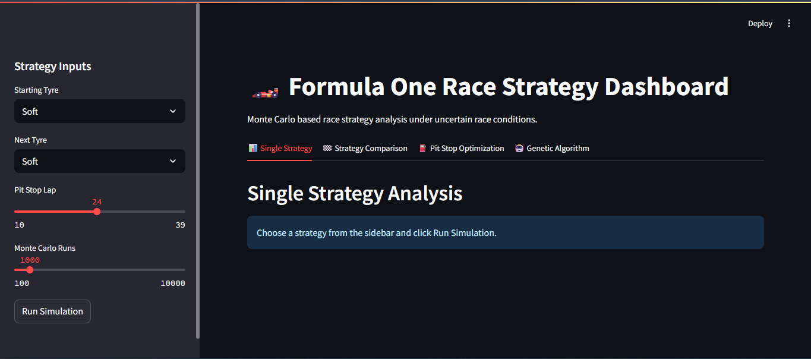

# 🏎️ Formula One Race Strategy Optimization Using Monte Carlo Simulation and Genetic Algorithm

<p align="center">
  
</p>

<p align="center">
An interactive Formula One race strategy decision support system developed using Monte Carlo Simulation and Genetic Algorithms under uncertain race conditions.
</p>

---

# Overview

This project presents an interactive Formula One race strategy optimization framework developed using Python, Monte Carlo Simulation, and Genetic Algorithms (GA).

The framework evaluates and optimizes race strategies by incorporating tyre performance modelling, tyre degradation behaviour, Safety Car deployment, weather uncertainty, and stochastic race events. The developed system allows users to simulate race scenarios, compare strategies, optimize pit-stop timing, and obtain near-optimal race strategies through an interactive Streamlit dashboard.

---

# Research Objectives

The objectives of this project are to:

- Develop a Formula One race simulation model using a lap-by-lap approach.
- Model tyre performance based on tyre pace and degradation characteristics.
- Simulate uncertain race conditions through Safety Car and weather events.
- Evaluate race strategies using Monte Carlo Simulation.
- Optimize pit-stop timing using brute-force optimization.
- Identify near-optimal race strategies using Genetic Algorithms.
- Develop an interactive dashboard for strategy analysis and decision support.

---

# Features

## ✅ Race Simulation Model

- Lap-by-lap race simulation
- Race time calculation
- Pit-stop modelling
- Strategy evaluation framework

## ✅ Tyre Performance Modelling

- Soft compound modelling
- Medium compound modelling
- Hard compound modelling
- Tyre pace model
- Piecewise degradation model

## ✅ Uncertainty Modelling

- Driver performance variability
- Safety Car deployment probability
- Weather uncertainty modelling
- Random race disturbances

## ✅ Monte Carlo Simulation

- Statistical race analysis
- Multiple race iterations
- Race-time distribution analysis
- Mean, best, worst, and standard deviation metrics

## ✅ Optimization

- Strategy comparison
- Brute-force optimization
- Pit-stop optimization
- Genetic Algorithm optimization

## ✅ Interactive Dashboard

- Single Strategy Analysis
- Strategy Comparison
- Pit Stop Optimization
- Genetic Algorithm Optimization
- Interactive visual analytics

---

# Dashboard Modules

| Module | Function |
|----------|----------|
| Single Strategy Analysis | Evaluate a user-defined strategy |
| Strategy Comparison | Compare multiple tyre strategies |
| Pit Stop Optimization | Determine the best pit-stop lap |
| Genetic Algorithm | Search for near-optimal race strategies |

---

# Methodology

```text
Input Parameters
        │
        ▼
Race Simulation Model
        │
        ▼
Tyre Performance Model
        │
        ▼
Uncertainty Modelling
(Safety Car + Weather)
        │
        ▼
Monte Carlo Simulation
        │
        ▼
Strategy Evaluation
        │
 ┌──────┴────────┐
 ▼               ▼
Brute Force   Genetic Algorithm
Optimization  Optimization
        │
        ▼
Optimal Strategy
```

---

# Technologies Used

| Technology | Purpose |
|------------|----------|
| Python | Simulation and optimization |
| NumPy | Numerical computation |
| Pandas | Data processing |
| Matplotlib | Data visualization |
| Streamlit | Interactive dashboard |
| PyGAD | Genetic Algorithm optimization |

---

# Project Structure

```text
F1-Race-Strategy-Optimization

├── src
│   ├── race_model.py
│   ├── monte_carlo.py
│   ├── main.py
│   └── genetic_algorithm.py
│
├── figures
│   ├── Dashboard.png
│   ├── MonteCarloHistogram.png
│   ├── PitStopOptimization.png
│   └── GA_ConvergenceCurve.png
│
├── results
│   ├── MonteCarloResults.csv
│   ├── StrategyComparison.csv
│   ├── PitOptimizationData.csv
│   └── GA_BestStrategy.csv
│
├── README.md
├── LICENSE
└── requirements.txt
```

---

# Installation

Clone the repository:

```bash
git clone https://github.com/najwazaqirah98/F1-Race-Strategy-Optimization.git
```

Navigate to the project directory:

```bash
cd F1-Race-Strategy-Optimization
```

Install dependencies:

```bash
pip install -r requirements.txt
```

Launch the dashboard:

```bash
streamlit run app.py
```

---

# Future Improvements

Potential future developments include:

- Multi-stop strategy optimization
- Fuel consumption modelling
- Dynamic weather forecasting
- Driver aggressiveness modelling
- Reinforcement Learning optimization
- Real-time telemetry integration

---

# Research Contribution

This project contributes an interactive Formula One race strategy decision support system that integrates tyre performance modelling, uncertainty modelling, Monte Carlo Simulation, and Genetic Algorithm optimization within a single framework. The developed platform enables users to evaluate, compare, and optimize race strategies under uncertain operating conditions through an intuitive graphical dashboard.

---

# Author

**Najwa Zaqirah Taufik**

---

# License

This project is released for academic and research purposes.
